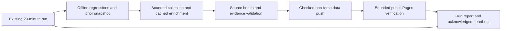

# RSS operational loop

Once this change is approved and deployed, the existing update job completes a
bounded collection-to-publication cycle without a separate human step per run.
The schedule, Windows dispatcher, runner settings and permissions stay as already
configured. This document grants no authority to merge future code or change
access controls.

The source/media audit procedure and proposed bounded media checkpoint stage are
documented in [SOURCE-MEDIA-QA.md](SOURCE-MEDIA-QA.md). That stage is implemented under the specific 2026-10-13 approval; rollout
remains gated. See the dated audit for original coverage and current release evidence.

## Automatic actions

- Keep the currently running build; queue newer work through the existing
  concurrency group. Preflight and time budgets fail predictably. The existing
  once-only fast native-crash retry is preserved; no new analysis retry is added.
- Fetch public sources with existing network guards and bounded per-source
  budgets. Deduplicate canonical articles. A failed source can retain recent
  previous articles with honest fetch/error/retention metadata; this does not
  count as a fresh observation. Denials and protected content remain unavailable.
- Reuse existing analysis/body/embedding caches and delivery acknowledgements.
  Keep current source-health transition/reminder dedupe. Optional stage failure
  remains visible while usable core data can survive bounded timeouts.
- Validate schema, complete sidecars and exact current-body quote evidence before
  pushing generated data. A failed prepublication gate leaves the previous
  generated publication in place. Retain a tracked public recovery archive.
- Attempt at most three non-force data pushes. Fetch and compare the source/assets
  against the tested revision before resync; changed source requires a new normal
  build. Trust only the current checkout for each Git command.
- Record the actual pushed commit, including successful no-change/resync paths.
  Read that commit's expected hashes, then check the fixed public Pages site.
  Poll the index first; once current, compare 14 core paths and up to five
  deterministic newest/evidence/partial-body sidecars. This is selected transport
  verification, alongside the full prepublication integrity gate.
- Public verification has a 90-second overall polling budget, at most twelve attempts,
  5/10/15-second capped backoff, eight-second requests, six parallel connections,
  guarded redirects/DNS/TLS and 8 MiB assets/sidecars. Only the fixed own-site
  articles.json and articles_index.json aggregates allow32MiB each; selected
  expected files total at most64MiB. Stream SHA256 and exact Git-expected decoded
  lengths in64KiB chunks, with bounded encoded/gzip/deflate expansion; never
  buffer a remote aggregate or change the generic8MiB publisher reader.
  Git size preflight and canonical archive reads share40seconds, at most20per
  command. A denial, unsafe destination or TLS failure stops
  polling. Reports contain revision, hashes and public source-health metadata;
  they contain no response bodies or provider credentials.
  Expected hashes use canonical commit bytes, with line-ending conversion
  disabled for the archive invocation only; runner Git settings remain intact.
- Write an Actions summary and a per-run verification artifact retained for three
  days. A daily success heartbeat follows verification. Existing transition-only
  failure notification and guardian reminders retain their existing recipients.
  The verifier itself never sends messages or repeats paid work.

## Failure handling

| First failed phase | Existing automatic response | What the report means |
|---|---|---|
| Source timeout / public denial / quiet feed | Bounded stale retention, honest source health, next ordinary run | Source unavailable or quiet; retained content is not fresh |
| Core / optional stage | Existing budgets/caches/partial save and status | Inspect the recorded failed stage; no unlimited retries |
| Offline / strict publication gate | Stop before data push, retain prior public snapshot | New generated data was not published by this run |
| Concurrent source change / push failure | Checked three-attempt non-force strategy, then fail | Do not force or mix output with untested source |
| Pages / CDN delay | Read-only polling, then unverified status and retained report | A data commit may already exist; public deployment is not confirmed |
| Repeated interruption / runner wedge | Existing guardian thresholds and deduplicated reporting | No new schedule or manual paid dispatch is introduced |

After post-push verification fails, inspect its revision/reason and the Pages
deployment. The next configured cycle can collect and verify again; do not rerun
paid analysis solely to retry a public read. No automatic rollback, arbitrary
code generation, recursive repair PRs or approval bypass is part of this loop.

## Code changes and rollout

Source repairs and loop changes are reviewed as focused draft PRs with exact-head
tests. An explicit approval covers the concrete merge/deployment. This runbook
does not establish a standing permission rule or bypass future review.

After approval, observe the first already configured Windows run. Confirm the
source readers' collection method, fresh counts and status, strict gate, pushed
SHA, public check artifact and Pages result. Hosted fixtures and Mac public reads
do not establish real Windows recovery. Physical Cantonese playback remains a
separate device check.
